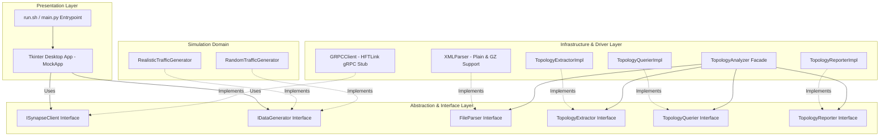
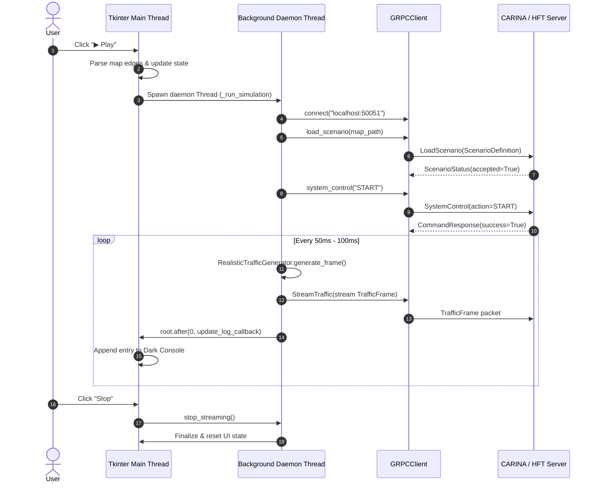

# 🏛️ SYNAPSE MOCK SERVER: System Blueprint & Client Architecture

This document specifies the internal engineering architecture of **SYNAPSE MOCK SERVER**. It details the clean architecture layers, the SOLID topology analysis subsystem, the multi-threaded Tkinter runtime model, the high-frequency gRPC client pipeline, and the mathematical formulations governing realistic traffic generation.

⬅️ Back to [Main Documentation Hub](docs/SYNAPSE_MOCK_MOC.md) | ⚡ See [API Reference](docs/API_REFERENCE.md) | 🗺️ See [Topology Analysis](docs/TOPOLOGY_ANALYSIS.md) | 🚗 See [Traffic Simulation](docs/TRAFFIC_SIMULATION.md)

---

## 1. Clean Architecture & Layered Decomposition

SYNAPSE MOCK SERVER is designed under strict **Clean Architecture** principles, enforcing clear boundaries between presentation, domain abstraction, and infrastructure implementations.



---

## 2. SOLID Topology Analysis Architecture

The network topology analysis module (`infrastructure/topology_analyzer.py`) was refactored from a monolithic class into a highly cohesive, loosely coupled system strictly adhering to the 5 **SOLID** principles:

```text
interfaces/
├── parser_interface.py       # FileParser abstract base class
└── topology_interface.py     # TopologyExtractor, TopologyQuerier, TopologyReporter

infrastructure/
├── parsers/
│   └── xml_parser.py         # Concrete XML and GZ ElementTree parser
├── topology/
│   ├── topology_extractor.py # Data structure extractors (EdgeInfo, JunctionInfo, ConnectionInfo)
│   ├── topology_querier.py   # Directional graph queries (upstream/downstream)
│   └── topology_reporter.py  # Formatted terminal summaries
└── topology_analyzer.py      # Facade coordinator with constructor Dependency Injection
```

### 2.1 Single Responsibility Principle (SRP)
Each class encapsulates a single reason to change:
- `XMLParser`: Parsing XML/GZ file content into in-memory XML trees.
- `TopologyExtractorImpl`: Extracting typed domain representations (`EdgeInfo`, `JunctionInfo`, `ConnectionInfo`).
- `TopologyQuerierImpl`: Navigating graph relationships across junctions.
- `TopologyReporterImpl`: Rendering topological summaries to standard output.
- `TopologyAnalyzer`: Serving as an orchestrating facade without implementing parsing or calculation logic directly.

### 2.2 Open/Closed Principle (OCP)
The system is open for extension but closed for modification. Supporting new network formats (e.g., GeoJSON, OpenDRIVE) requires implementing `FileParser` without altering existing extraction or querying logic.

### 2.3 Liskov Substitution Principle (LSP)
Any implementation conforming to `FileParser`, `TopologyExtractor`, `TopologyQuerier`, or `TopologyReporter` can be substituted transparently into `TopologyAnalyzer` without altering correctness.

### 2.4 Interface Segregation Principle (ISP)
Rather than a single bloated interface, interfaces are segregated into focused contracts (`FileParser`, `TopologyExtractor`, `TopologyQuerier`, `TopologyReporter`).

### 2.5 Dependency Inversion Principle (DIP)
High-level modules do not depend on low-level modules; both depend on abstractions:
```python
class TopologyAnalyzer:
    def __init__(self, 
                 parser: FileParser = None,
                 extractor: TopologyExtractor = None,
                 querier: TopologyQuerier = None,
                 reporter: TopologyReporter = None):
        self.parser = parser or XMLParser()
        self.extractor = extractor or TopologyExtractorImpl()
        self.querier = querier or TopologyQuerierImpl()
        self.reporter = reporter or TopologyReporterImpl()
```

---

## 3. Concurrency & Multi-Threading Model

Desktop responsiveness and sub-millisecond network streaming require strict thread isolation:



### 3.1 Main Thread (Tkinter GUI Event Loop)
- Manages window drawing, widgets, event bindings, and user interactions.
- Remains non-blocking at all times to prevent UI freezing during network I/O.

### 3.2 Worker Thread (`_run_simulation`)
- Executes asynchronously as a daemon thread (`daemon=True`).
- Manages connection retries, binary scenario upload, command synchronization, and frame generation.

### 3.3 Thread-Safe GUI Dispatch (`root.after`)
- Python's Tkinter is not thread-safe. All updates from the background streaming worker to the UI log console (`self.log_area`) are dispatched through `self.root.after(0, _update)`, scheduling the GUI update onto the main thread safely.

---

## 4. Synapse HFT gRPC Client Pipeline

Communication with CARINA follows a deterministic multi-stage protocol lifecycle:

```text
[1. Disconnected] 
        │
        ▼ (connect)
[2. Channel Open] ───► Insecure HTTP/2 gRPC Channel (localhost:50051)
        │
        ▼ (load_scenario)
[3. Scenario Transferred] ───► SHA-256 Checksum + Compressed Map + ADAGIO Schedule
        │
        ▼ (system_control: START)
[4. System Unlocked] ───► Handshake Confirmed by Controller
        │
        ▼ (stream_traffic)
[5. Active Streaming] ───► High-Frequency TrafficFrame Yield Loop (10-20 Hz)
```

1. **Connection Establishment:** Initializes an insecure HTTP/2 gRPC channel with `synapse.hft.HFTLinkStub`.
2. **Scenario Transfer (`LoadScenario`):** Computes the SHA-256 digest of the compressed `.net.xml.gz` file, attaches the extracted ADAGIO `peak_schedule.json`, and transmits the `ScenarioDefinition` payload.
3. **Control Handshake (`SystemControl`):** Dispatches an explicit `START` action to unlock CARINA's ingestion engine.
4. **Streaming Loop (`StreamTraffic`):** Executes a generator yielding `TrafficFrame` messages containing occupancy, mean speed, queue length, and density for every active edge, sleeping for a random jitter window of 50 to 100 ms between frames.

---

## 5. Traffic Simulation Formulations

### 5.1 Diurnal Time-of-Day Curve $F(t)$
The realistic traffic generator models real-world traffic variation through piecewise trigonometric curves:

$$
F(h) = \begin{cases} 
0.2, & 2 \le h \le 5 \quad \text{(Madrugada)} \\
0.2 + (h - 6) \times 0.2, & 6 \le h \le 8 \quad \text{(Rampa matutina)} \\
0.8 - (h - 9) \times 0.1, & 9 \le h \le 11 \quad \text{(Pico matutino)} \\
0.5 + 0.1 \sin\left(\frac{(h - 12)\pi}{3}\right), & 12 \le h \le 15 \quad \text{(Entre-picos)} \\
0.6 + 0.4 \sin\left(\frac{(h - 16)\pi}{3}\right), & 16 \le h \le 19 \quad \text{(Pico vespertino)} \\
0.4 - 0.2 \cos\left(\frac{(h - 20)\pi}{4}\right), & \text{demais horários} 
\end{cases}
$$

### 5.2 Deterministic 1-Minute Scenario Hash
To prevent chaotic frame-by-frame fluctuations and simulate stable physical vehicle waves, traffic states are seeded deterministically per 1-minute window:

$$\text{Seed}(t, e) = \left\lfloor \frac{t}{60} \right\rfloor \mathbin{\Vert} e$$

Each 1-minute block randomly chooses one of 4 physical regimes:
1. **Via Livre (Free Flow):** Occupancy $\in [0.0, 0.2]$, Speed $\in [70, 120]\text{ km/h}$, Density $\in [0, 20]$, Queue $= 0-5$.
2. **Tráfego Moderado (Moderate):** Occupancy $\in [0.3, 0.5]$, Speed $\in [40, 60]\text{ km/h}$, Density $\in [30, 50]$, Queue $= 10-20$.
3. **Congestionamento Leve (Light Congestion):** Occupancy $\in [0.6, 0.8]$, Speed $\in [20, 35]\text{ km/h}$, Density $\in [60, 90]$, Queue $= 30-60$.
4. **Congestionamento Severo (Severe Congestion):** Occupancy $\in [0.85, 1.0]$, Speed $\in [2, 8]\text{ km/h}$, Density $\in [100, 150]$, Queue $= 80-150$.

---

<div align="center">
  <br/>
  <b>Noxfort Systems</b> — <i>A State Of Art Company</i><br/>
  <i>Client Architecture Blueprint • SYNAPSE MOCK SERVER v1.2.0</i><br/>
  <small>© 2026 Gabriel Moraes - Noxfort Systems. Licensed under Apache 2.0.</small>
</div>
