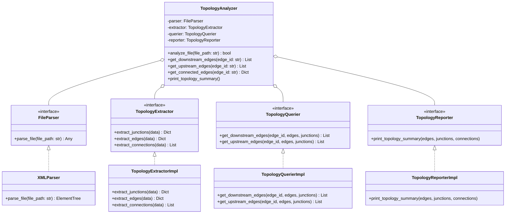

# 🗺️ Topology Analysis Engine & SUMO Parsers

This document provides a comprehensive guide to the **Topology Analysis Engine** in SYNAPSE MOCK SERVER. It explains the parsing of SUMO `.net.xml` networks, the modular SOLID architecture, graph data structures, and directional querying algorithms.

⬅️ Back to [Main Documentation Hub](SYNAPSE_MOCK_MOC.md) | 🏛️ See [Architecture](ARCHITECTURE.md) | ⚡ See [API Reference](API_REFERENCE.md)

---

## 1. Overview & Network Topology in SUMO

In microscopic traffic simulation environments (such as SUMO), road networks are defined as directed graphs composed of:
- **Junctions (Nodes):** Intersections where streets connect. Controlled junctions include traffic signal logic (`type="traffic_light"`).
- **Edges (Links):** Directional roadway links between junctions. Edges contain one or more parallel lanes.
- **Connections:** Explicit lane-to-lane directional links governing turn movements.
- **Internal Edges:** Intermediate connector edges within junctions, indicated by a `:` prefix (e.g., `:gneJ1_0_0`). These are automatically filtered out during edge extraction.

---

## 2. SOLID Architecture Breakdown

To guarantee high testability and maintainability, the topology subsystem is segregated into modular components adhering to **SOLID**:



---

## 3. Data Structures

The extraction pipeline transforms raw XML into typed domain objects:

### 3.1 `EdgeInfo`
```python
@dataclass
class EdgeInfo:
    id: str
    from_node: str
    to_node: str
    num_lanes: int
    speed: float
    length: float
    lanes: List[Dict[str, Any]]
    shape: Optional[List[tuple]] = None
```

### 3.2 `JunctionInfo`
```python
@dataclass
class JunctionInfo:
    id: str
    x: float
    y: float
    type: str
    inc_edges: Set[str] = field(default_factory=set)
    out_edges: Set[str] = field(default_factory=set)
```

### 3.3 `ConnectionInfo`
```python
@dataclass
class ConnectionInfo:
    from_edge: str
    to_edge: str
    from_lane: int
    to_lane: int
    tl_id: Optional[str] = None
    link_index: Optional[int] = None
```

---

## 4. Directional Adjacency Querying

The `TopologyQuerierImpl` resolves upstream and downstream topological relationships across the road network:

### 4.1 Downstream Edge Resolution (`get_downstream_edges`)
1. Looks up the destination junction (`to_node`) of the target edge:
   $$\text{junction} = \text{edges}[e].\text{to\_node}$$
2. Returns all outgoing edges from that junction, excluding reverse or self-loops:
   $$\mathcal{E}_{\text{down}} = \text{junctions}[\text{junction}].\text{out\_edges} \setminus \{e\}$$

### 4.2 Upstream Edge Resolution (`get_upstream_edges`)
1. Looks up the origin junction (`from_node`) of the target edge:
   $$\text{junction} = \text{edges}[e].\text{from\_node}$$
2. Returns all incoming edges connected to that junction, excluding the target edge:
   $$\mathcal{E}_{\text{up}} = \text{junctions}[\text{junction}].\text{inc\_edges} \setminus \{e\}$$

---

## 5. Usage Example

```python
from infrastructure.topology_analyzer import TopologyAnalyzer

# Initialize analyzer with default SOLID dependencies
analyzer = TopologyAnalyzer()

# Analyze SUMO network (plain or gzip compressed)
success = analyzer.analyze_file("data/maps/sample.net.xml.gz")

if success:
    # Print formatted console report
    analyzer.print_topology_summary()
    
    # Query directional topology
    downstream = analyzer.get_downstream_edges("edge_main_avenue")
    upstream = analyzer.get_upstream_edges("edge_main_avenue")
    
    print(f"Downstream edges: {downstream}")
    print(f"Upstream edges: {upstream}")
```

---

<div align="center">
  <br/>
  <b>Noxfort Systems</b> — <i>A State Of Art Company</i><br/>
  <i>Topology Analysis Guide • SYNAPSE MOCK SERVER v1.2.0</i>
</div>
