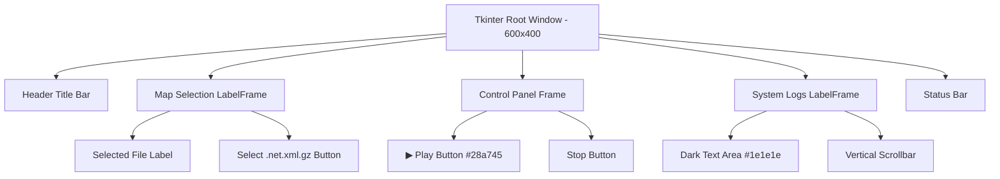
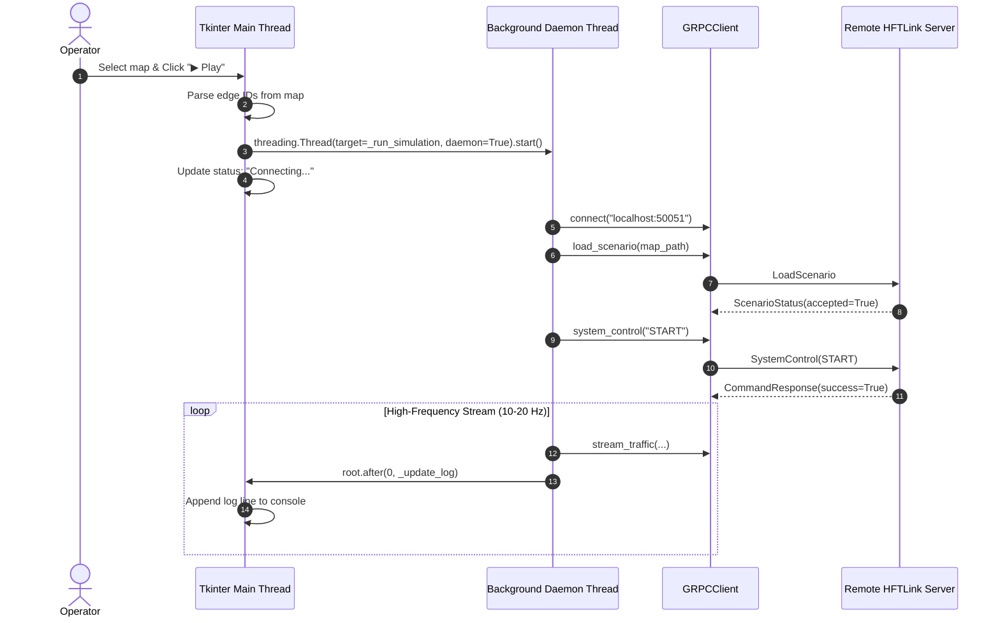

# 🖥️ Tkinter UI & Test Harness Architecture

This document details the graphical presentation tier of SYNAPSE MOCK SERVER. It explains the **`MockApp`** Tkinter dashboard, thread decoupling, map validation, and asynchronous console logging.

⬅️ Back to [Main Documentation Hub](SYNAPSE_MOCK_MOC.md) | 🏛️ See [Architecture](ARCHITECTURE.md) | ⚡ See [API Reference](API_REFERENCE.md)

---

## 1. Interface Layout & Component Hierarchy

The desktop interface (`ui/app_ui.py`) provides operators with a simple, high-visibility control console:



### 1.1 Visual Elements Breakdown
- **Map Selection Panel:** Displays the active road network path and opens the OS file picker.
- **Controls Panel:**
  - `▶ Play` button: Triggers parsing, spawns the background worker, and locks UI controls.
  - `Stop` button: Signals the streaming loop to stop and resets controls.
- **Dark Console (`#1e1e1e`):** Fixed-width console (`Consolas`, 9pt) outputting timestamped transmission events.
- **Status Bar:** Bottom banner showing connection and operational states.

---

## 2. Multi-Threaded Execution Model

Network streaming and file decompression must not execute on the Tkinter main thread, as doing so freezes the GUI.



### 2.1 Thread-Safe Log Dispatch (`root.after`)
Tkinter requires that all widget modifications happen strictly on the main thread:

```python
def log(self, message):
    timestamp = time.strftime("%H:%M:%S")
    full_message = f"[{timestamp}] {message}\n"
    print(full_message.strip())
    
    def _update():
        self.log_area.config(state="normal")
        self.log_area.insert(tk.END, full_message)
        self.log_area.see(tk.END)
        self.log_area.config(state="disabled")
    
    # Safely schedule widget update onto Tkinter event loop
    self.root.after(0, _update)
```

---

## 3. Resilient Auto-Reconnection

If the gRPC connection to the server drops during streaming, `_run_simulation` captures the exception and enters an automated reconnection loop:

1. Logs the disconnect event: `CONNECTION LOST: <reason>`.
2. Updates UI status: `Status: Connection lost. Retrying...`.
3. Pauses for 3 seconds.
4. Attempts re-connection and scenario reloading automatically until stopped by the user.

---

<div align="center">
  <br/>
  <b>Noxfort Systems</b> — <i>A State Of Art Company</i><br/>
  <i>UI & Test Harness Guide • SYNAPSE MOCK SERVER v1.2.0</i>
</div>
