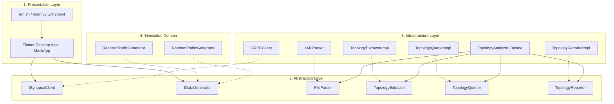
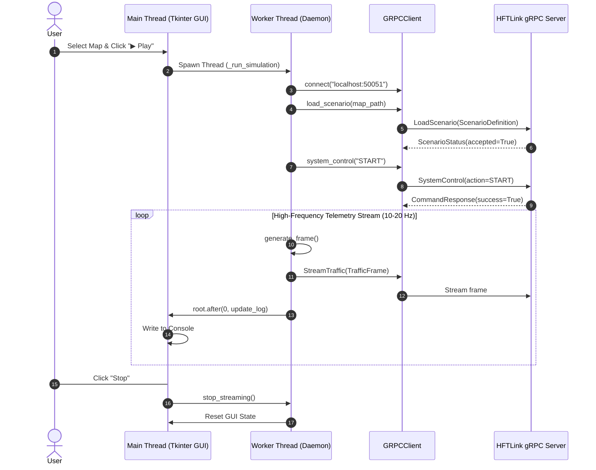

# 🏛️ SYNAPSE MOCK SERVER: Architecture & System Blueprint

This document details the software engineering architecture of **SYNAPSE MOCK SERVER**. Designed as an industrial test harness for the Synapse HFT protocol, it enforces high decoupling via Clean Architecture and SOLID design patterns.

⬅️ Back to [Main Documentation Hub](synapse_mock_moc.md) | ⚡ See [API Reference](api_reference.md) | 🗺️ See [Topology Analysis](topology_analysis.md) | 🚗 See [Traffic Simulation](traffic_simulation.md)

---

## 1. System Decomposition & Layering

The application is structured into four distinct logical layers:

---

## 2. SOLID Architectural Principles

The topology analysis module (`infrastructure/topology_analyzer.py`) was restructured to fulfill all 5 SOLID principles:

### 2.1 Single Responsibility Principle (SRP)
- **`XMLParser`**: Solely responsible for XML and GZ parsing into element trees.
- **`TopologyExtractorImpl`**: Solely responsible for mapping XML nodes into strongly-typed dataclasses (`EdgeInfo`, `JunctionInfo`, `ConnectionInfo`).
- **`TopologyQuerierImpl`**: Solely responsible for upstream and downstream adjacency queries.
- **`TopologyReporterImpl`**: Solely responsible for human-readable terminal summaries.
- **`TopologyAnalyzer`**: Functions purely as a coordinator facade.

### 2.2 Open/Closed Principle (OCP)
The system is open for extension without modifying existing code. To support a new network format (such as OpenDRIVE or GeoJSON), implement the `FileParser` interface and inject it into `TopologyAnalyzer`.

### 2.3 Liskov Substitution Principle (LSP)
All concrete implementations can be substituted wherever their corresponding interface is expected without altering correctness or breaking assumptions.

### 2.4 Interface Segregation Principle (ISP)
Client code only depends on the interfaces it consumes (`FileParser`, `TopologyExtractor`, `TopologyQuerier`, `TopologyReporter`).

### 2.5 Dependency Inversion Principle (DIP)
High-level policies depend upon abstract contracts rather than concrete low-level implementations. Constructor injection provides sensible defaults while allowing complete mockability in unit tests.

---

## 3. Concurrency & Multi-Threading Model

Desktop interfaces must remain responsive while high-frequency network streaming occurs. SYNAPSE MOCK SERVER resolves this through multi-threaded decoupling:

---

   
  <b>Noxfort Systems</b> — <i>A State Of Art Company</i> 
  <i>System Architecture • SYNAPSE MOCK SERVER v1.2.0</i>

