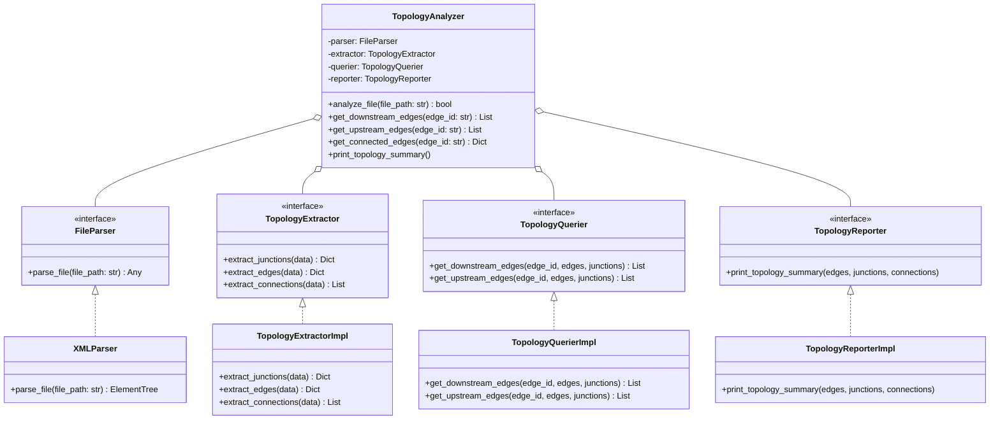

# 🗺️ Topology Analysis Engine & SUMO Parsers

This document provides a comprehensive guide to the **Topology Analysis Engine** in SYNAPSE MOCK SERVER. It explains the parsing of SUMO `.net.xml` networks, the modular SOLID architecture, graph data structures, and directional querying algorithms.

⬅️ Back to [Main Documentation Hub](synapse_mock_moc.md) | 🏛️ See [Architecture](architecture.md) | ⚡ See [API Reference](api_reference.md)

---

## 1. Overview & Network Topology in SUMO

In microscopic traffic simulation environments (such as SUMO), road networks are defined as directed graphs composed of:
- **Junctions (Nodes):** Intersections where streets connect. Controlled junctions include traffic signal logic (`type="traffic_light"`).
- **Edges (Links):** Directional roadway links between junctions. Edges contain one or more parallel lanes.
- **Connections:** Explicit lane-to-lane directional links governing turn movements.
- **Internal Edges:** Intermediate connector edges within junctions, indicated by a `:` prefix. These are automatically filtered out during edge extraction.

---

## 2. SOLID Architecture Breakdown

To guarantee high testability and maintainability, the topology subsystem is segregated into modular components adhering to **SOLID**:



---

## 3. Directional Adjacency Querying

```python
from infrastructure.topology_analyzer import TopologyAnalyzer

analyzer = TopologyAnalyzer()
if analyzer.analyze_file("data/maps/sample.net.xml.gz"):
    analyzer.print_topology_summary()
    downstream = analyzer.get_downstream_edges("edge_main_avenue")
    upstream = analyzer.get_upstream_edges("edge_main_avenue")
```

---

<div align="center">
  <br/>
  <b>Noxfort Systems</b> — <i>A State Of Art Company</i><br/>
  <i>Topology Analysis Guide • SYNAPSE MOCK SERVER v1.2.0</i>
</div>
