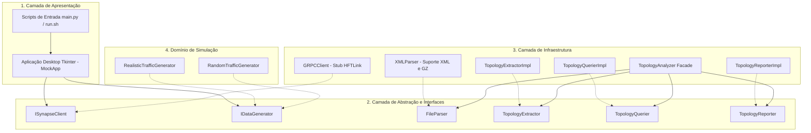

# 🏛️ SYNAPSE MOCK SERVER: Arquitetura do Sistema

Este documento detalha a arquitetura de software do **SYNAPSE MOCK SERVER**, incluindo a divisão em camadas Clean Architecture, a refatoração SOLID do analisador de topologia, o modelo de concorrência multithread da UI e o ciclo de vida do cliente gRPC.

⬅️ Voltar para o [Hub de Documentação](synapse_mock_moc.md) | ⚡ Ver [Referência da API](api_reference.md) | 🗺️ Ver [Análise de Topologia](topology_analysis.md)

---

## 1. Decomposição em Camadas (Clean Architecture)

O sistema é dividido em quatro camadas bem delimitadas:

---

## 2. Princípios SOLID Aplicados

O subsistema de topologia foi refatorado a partir de um código monolítico para atender aos 5 princípios SOLID:

1. **Responsabilidade Única (SRP):**
   - `XMLParser`: Focado unicamente na leitura do XML/GZ.
   - `TopologyExtractorImpl`: Focado unicamente na extração de nós, vias e conexões.
   - `TopologyQuerierImpl`: Focado nas buscas de relacionamentos no grafo.
   - `TopologyReporterImpl`: Focado na impressão dos relatórios.
   - `TopologyAnalyzer`: Fachada sem regras de negócio duras.
2. **Aberto/Fechado (OCP):** Novos formatos de arquivo (ex.: GeoJSON ou OpenDRIVE) podem ser integrados implementando `FileParser` sem modificar as classes existentes.
3. **Substituição de Liskov (LSP):** Qualquer classe que implemente as interfaces pode substituir a padrão sem alterar o comportamento do sistema.
4. **Segregação de Interfaces (ISP):** Interfaces compactas e com propósitos específicos em `interfaces/`.
5. **Inversão de Dependências (DIP):** O `TopologyAnalyzer` recebe suas dependências via construtor, operando sobre abstrações.

---

## 3. Modelo de Concorrência e Threads da UI

Para assegurar que a interface gráfica permaneça fluida durante a transmissão gRPC em alta frequência (10 a 20 quadros por segundo), o processamento ocorre em threads separadas:

- **Thread Principal (Tkinter GUI):** Responsável pela renderização de janelas, captura de cliques do usuário e atualização de widgets.
- **Thread Secundária (`_run_simulation`):** Executada em segundo plano como daemon (`daemon=True`), responsável pela conexão de rede, upload do cenário e envio contínuo de quadros.
- **Despacho Seguro com `root.after`:** O Tkinter não é thread-safe. Por essa razão, todos os logs emitidos pela thread secundária chamam `self.root.after(0, _update)`, agendando a escrita no console diretamente na fila de eventos da thread principal.

---

   
  <b>Noxfort Systems</b> — <i>A State Of Art Company</i> 
  <i>SYNAPSE MOCK SERVER v1.2.0 • Arquitetura</i>

